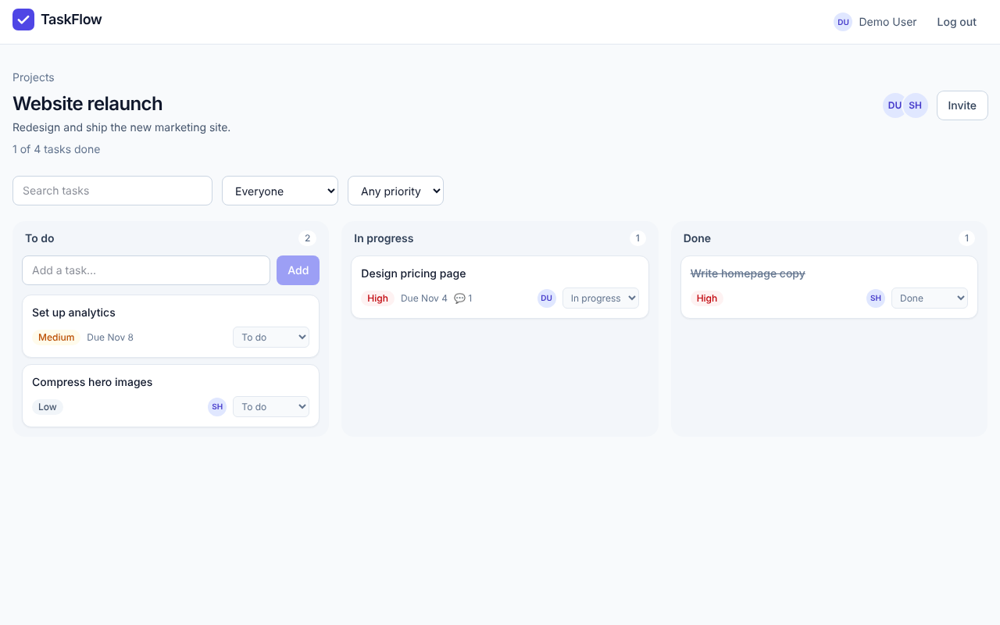
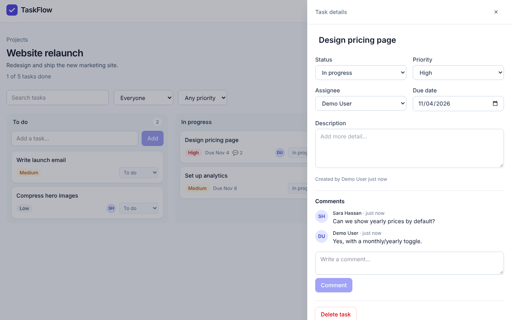
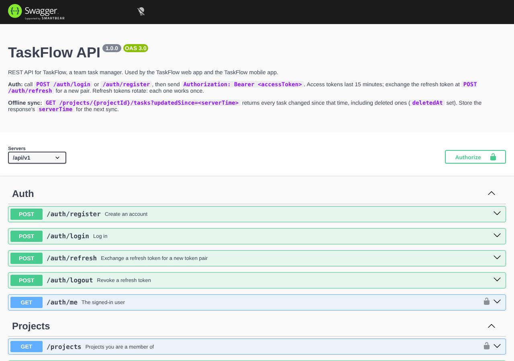

# TaskFlow

[](https://github.com/youssefabotaleb20/taskflow-taskmanager/actions/workflows/ci.yml)

A task manager for small teams: projects, a three-column board, assignees, due dates and comments.
**Live demo:** [taskflow-web-woad.vercel.app](https://taskflow-web-woad.vercel.app) · **API docs:** [taskflow-api-opal-ten.vercel.app/docs](https://taskflow-api-opal-ten.vercel.app/docs)

It's a TypeScript monorepo with a REST API and a React web app. The API is also built to serve a React Native mobile app, so it has token refresh and offline sync.



| Task details and comments | API docs (Swagger) |
| --- | --- |
|  |  |

## Features

- **Accounts:** sign up, log in, short-lived JWT access tokens with rotating refresh tokens
- **Projects:** create projects, invite teammates by email, remove members or leave a project
- **Tasks:** status, priority, assignee, due date, description; search and filter; overdue flags
- **Comments:** threaded under each task, with a live comment count on the board
- **Permissions:** only members see a project (others get a 404), only the owner can manage it, only the creator or owner can delete a task
- **Offline sync for mobile:** `GET /projects/:id/tasks?updatedSince=<time>` returns everything changed since the last sync, deletions included
- **Accessible UI:** labelled controls, keyboard support (Escape closes the task panel), skip link, reduced-motion support, works at phone width

## Tech stack

| Layer | Tools |
| --- | --- |
| API | Node.js 22, Express 5, TypeScript, MongoDB with Mongoose, Zod validation, JWT, bcrypt, Helmet, rate limiting, pino logging |
| API docs | OpenAPI 3 with Swagger UI at `/docs` |
| Web | React 19, Vite, TypeScript, React Router, TanStack Query, Tailwind CSS 4 |
| Testing | Vitest, Supertest and mongodb-memory-server (API); React Testing Library, user-event and MSW (web) |
| DevOps | Docker, Docker Compose, GitHub Actions, Vercel (serverless), MongoDB Atlas |

## Architecture

```
┌──────────────┐     HTTPS + JSON      ┌──────────────────────┐      ┌──────────────┐
│  React web   │ ───────────────────▶  │  Express API (/api/v1)│ ───▶ │   MongoDB    │
│  (Vite, RQ)  │  Bearer access token  │  auth · projects ·    │      │  (Atlas)     │
└──────────────┘                       │  tasks · comments     │      └──────────────┘
┌──────────────┐                       │  Swagger at /docs     │
│ React Native │ ───────────────────▶  └──────────────────────┘
│ (coming next)│   same API + sync
└──────────────┘
```

```
api/
  src/
    config/env.ts        validated environment variables
    models/              User, Project, Task, Comment, RefreshToken
    routes/              auth, projects (+ members), tasks (+ comments)
    services/            tokens (JWT + refresh rotation), access checks
    docs/openapi.ts      the OpenAPI document behind /docs
  test/                  integration tests against an in-memory MongoDB
web/
  src/
    lib/                 API client with token refresh, auth context, React Query hooks
    pages/               login/register, projects, board, task panel
    test/                React Testing Library tests with an MSW fake API
```

## Run it locally

You need Node.js 22 and either Docker or a local MongoDB.

**Everything in Docker:**

```bash
docker compose up --build
# Web: http://localhost:8080   API: http://localhost:4000   Docs: http://localhost:4000/docs
```

**For development:**

```bash
npm install
cp api/.env.example api/.env        # set JWT_SECRET
cp web/.env.example web/.env
docker run -d -p 27017:27017 mongo:7 # or use your own MongoDB
npm run seed                         # demo data: demo@taskflow.dev / taskflow-demo
npm run dev:api                      # http://localhost:4000
npm run dev:web                      # http://localhost:5173
```

## Tests

```bash
npm test          # API and web
npm run lint
npm run typecheck
```

- **API (29 tests):** each test hits the real Express app through Supertest, backed by a throwaway in-memory MongoDB. They cover auth and token rotation, permissions, filters, pagination, sync and comment counts.
- **Web (29 tests):** React Testing Library renders the whole app and drives it the way a user would (labels, roles, keyboard). MSW stands in for the API with the same response shapes, so the tests cover login, the board, filters, the task panel, comments and the token-refresh logic in the API client.

GitHub Actions runs lint, typecheck, tests and builds for both packages on every push and pull request, then builds both Docker images.

## API overview

All routes are under `/api/v1`. Full request and response schemas are at `/docs`.

| Method | Path | Notes |
| --- | --- | --- |
| POST | `/auth/register`, `/auth/login` | Returns `user`, `accessToken`, `refreshToken` |
| POST | `/auth/refresh` | Exchanges a refresh token for a new pair; each refresh token works once |
| POST | `/auth/logout` | Revokes a refresh token |
| GET | `/auth/me` | The signed-in user |
| GET, POST | `/projects` | Your projects; create one |
| GET, PATCH, DELETE | `/projects/:id` | Details with task counts; owner-only edits |
| POST, DELETE | `/projects/:id/members[/:userId]` | Invite by email; remove or leave |
| GET, POST | `/projects/:id/tasks` | Filters: `status`, `priority`, `assignee` (`me`, `none`, id), `q`, `updatedSince`, `sort`, `page`, `limit` |
| GET, PATCH, DELETE | `/tasks/:id` | |
| GET, POST | `/tasks/:id/comments` | |
| DELETE | `/comments/:id` | Author or project owner |

Errors always look like `{ "error": { "code": "bad_request", "message": "...", "details": { "field": ["..."] } } }`.

### Notes for the mobile app

- Store both tokens in secure storage. On a 401, call `/auth/refresh` once and retry; `web/src/lib/api.ts` shows the pattern.
- For offline sync, keep the `serverTime` from each task list response and pass it back as `updatedSince` next time. Tasks with `deletedAt` set should be removed locally.

## Deploy (free, no card)

The live demo runs on Vercel's free Hobby plan with a free MongoDB Atlas M0 cluster. It's two Vercel projects from this one repo:

| Project | Root Directory | Environment variables |
| --- | --- | --- |
| API | `api` | `MONGODB_URI`, `JWT_SECRET`, `CORS_ORIGINS` (the web app's URL), `NODE_ENV=production` |
| Web | `web` | `VITE_API_URL` (the API's URL) |

On Vercel the API runs as one serverless function (`api/api/index.js`) that wraps the same Express app and reuses the MongoDB connection between requests. `api/vercel.json` and `web/vercel.json` hold the routing. In Atlas, allow network access from anywhere, because Vercel has no fixed IPs.

The repo also works on Render (`render.yaml`) or any Docker host (`api/Dockerfile`, `web/Dockerfile`), but Render now asks for a card even on its free plan.

## License

MIT
