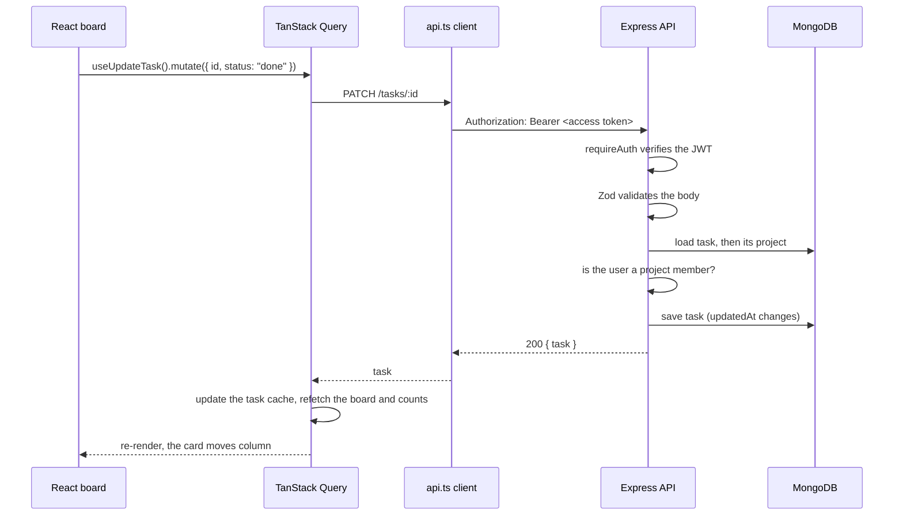
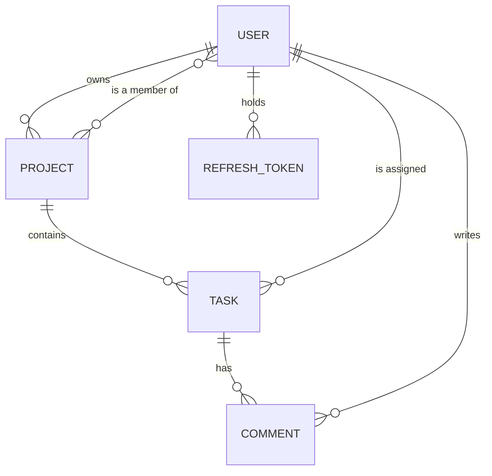

# TaskFlow architecture

This document explains how TaskFlow works under the hood and why it's built the way it is. The [README](../README.md) covers features, setup and the API at a glance.

## The pieces

| Part | Where it runs | What it does |
| --- | --- | --- |
| Web app (`web/`) | Vercel, static files | React single-page app. Talks to the API over HTTPS with a Bearer token. |
| API (`api/`) | Vercel, one serverless function | Express app behind `/api/v1`. Validates input, checks permissions, reads and writes MongoDB. Serves its own OpenAPI docs at `/docs`. |
| Database | MongoDB Atlas, free M0 cluster | Five collections: users, refresh tokens, projects, tasks, comments. |
| Mobile app | Next project | React Native client that will use the same API, including token refresh and offline sync. |

The same Express app runs in three places without changes: on Vercel through `api/api/index.js`, in Docker through `api/Dockerfile`, and locally through `npm run dev:api`. Only the entry point differs.

## A request, end to end

Here's what happens when someone drags a task to "Done" on the board:



If the access token has expired, the API answers 401. The client then calls `POST /auth/refresh` once, stores the new token pair and retries the original request. If several requests fail at the same moment, they all wait on that single refresh rather than starting one each (`web/src/lib/api.ts`). If the refresh fails too, the client clears the tokens and sends the user to the login page.

### Inside the API

```
request
  → helmet (security headers) → cors (allowed origins only) → JSON body parser (100 KB limit)
  → /api/v1/auth/*      rate-limited, no token needed (except /me)
  → /api/v1/projects/*  requireAuth → route handler
  → /api/v1/tasks/*, /comments/*  requireAuth → route handler
  → notFound → errorHandler
```

Each handler follows the same pattern:
1. **Parse:** run Zod over the body or query. A failure becomes a `400` with errors listed per field.
2. **Load and authorize:** helpers in `services/access.ts` load the project or task and check membership.
3. **Act:** read or write with Mongoose.
4. **Respond:** return JSON. Documents expose `id` rather than `_id`, and never include password hashes.

Express 5 passes errors thrown in async handlers straight to the error handler, so no route needs its own try/catch. All errors share one shape: `{ error: { code, message, details? } }`.

## Data model



| Collection | Key fields | Indexes |
| --- | --- | --- |
| `users` | name, email (unique, lowercased), passwordHash (hidden by default) | email |
| `refreshtokens` | user, tokenHash (unique), expiresAt | TTL on expiresAt, so MongoDB deletes expired tokens on its own |
| `projects` | name, description, owner, members[] | members |
| `tasks` | project, title, description, status, priority, assignee, dueDate, createdBy, commentCount, deletedAt | (project, status, createdAt) for the board; (project, updatedAt) for sync |
| `comments` | task, author, body | (task, createdAt) |

**Members live inside the project document** as an array of user ids. A small team's project never has more than a handful of members, and the most common check, "is this user a member?", then takes a single read with no join.

**`commentCount` is stored on the task** rather than counted each time. The board shows a comment count on every card, and counting comments for 50 cards on every board load would be wasteful. The count goes up and down in the same handlers that create and delete comments.

**Tasks are soft-deleted.** Deleting a task sets `deletedAt` instead of removing the document. Normal lists hide those tasks, but a sync request returns them, so an offline mobile client can find out that a task it has cached was deleted.

## Security model

- **Passwords** are hashed with bcrypt at cost 12. Login gives the same "Email or password is incorrect" message whether the email exists or not.
- **Access tokens** are JWTs signed with HS256. They last 15 minutes and carry only the user id. The algorithm is pinned when verifying, so a token can't switch it.
- **Refresh tokens** are random 48-byte strings. Only their SHA-256 hash is stored, so a leaked database can't be used to sign in. Each refresh token works once: using it deletes it and issues a new pair (rotation). Logout deletes it.
- **Authorization is checked on every route, from the data.** A user who isn't a member gets a 404, not a 403, so project and task ids don't reveal that they exist. Only the owner can rename or delete a project and manage members. Only a task's creator or the project owner can delete it. Assignees must be project members.
- **Input** is validated with Zod at the edge, and Mongoose's schema limits act as a second check. Search text is escaped before it's used in a regex, so `(` or `.*` can't break or slow down a query.
- **Transport and headers:** Helmet sets the security headers. CORS allows only the configured web origins. Request bodies are capped at 100 KB. Login, register and refresh are rate-limited to 50 requests per 15 minutes per IP.
- **Secrets** (`MONGODB_URI`, `JWT_SECRET`) live only in the host's environment settings. The API refuses to start if `JWT_SECRET` is missing or shorter than 16 characters.

## Key decisions

| Decision | What we chose | What we rejected, and why |
| --- | --- | --- |
| Auth tokens | Short JWT access token plus a rotating opaque refresh token, both returned in the JSON body | **Cookie sessions:** awkward for the React Native app, and they need CSRF protection. **One long-lived JWT:** can't be revoked, so a stolen token stays valid until it expires. |
| Refresh token format | Random string, stored hashed | **A JWT refresh token:** it can't be revoked without a lookup anyway, so signing it adds nothing. |
| Database | MongoDB with Mongoose | **PostgreSQL with Prisma** (the first plan): MongoDB was chosen to cover a skill with no project behind it yet. The data is small and document-shaped (a project with its members, a task with its fields), so it fits well. |
| Validation | Zod schemas in each route | **Mongoose validation only:** its error messages are poor, and bad input would reach the database layer first. |
| Mobile offline support | `updatedSince` sync on the existing list endpoint, plus soft deletes | **A separate sync API, or websockets:** more to build and run, and polling on app open is enough for a task app. |
| API docs | A hand-written OpenAPI object, served through Swagger UI loaded from a CDN | **Generating docs from JSDoc comments:** that splits the spec across files. **`swagger-ui-express`:** it serves static files from `node_modules`, which serverless functions don't reliably bundle. |
| Hosting | Vercel Hobby (free, no card) with MongoDB Atlas M0 | **Render:** the first plan, and `render.yaml` was written for it, but Render now needs a card even on its free plan, and the brief was zero spending. |
| Web data layer | TanStack Query | **Redux or hand-written `useEffect` fetching:** caching, refetching and invalidation after a change would all have to be written by hand. |
| Web tests | React Testing Library plus MSW, rendering the whole app | **Mocking `fetch` or the API module:** that tests the wiring rather than what the user sees. MSW keeps the real client code, token refresh included, in every test. |

## Testing strategy

- **API:** integration tests through Supertest against the real Express app, with a fresh in-memory MongoDB (`mongodb-memory-server`). The tests are organized by feature and focus on rules: permissions, token rotation, filters, sync and comment counts.
- **Web:** React Testing Library renders the full app with its router and providers. Tests find elements by role and label, the way a screen reader would. MSW serves a small in-memory fake API with the real response shapes.
- **CI** (GitHub Actions) runs lint, typecheck, tests and builds for both packages, then builds both Docker images, on every push and pull request.

## Known limits

- **Rate limiting is per serverless instance.** On Vercel the counters live in memory, so they reset when an instance spins down, and separate instances don't share them. A shared store such as Redis would fix this.
- **Tokens are kept in `localStorage`** in the web app. That's simple and works the same way as the mobile app, but any XSS bug could read them. An httpOnly cookie for the web client would be safer.
- **Refresh-token reuse isn't treated as theft.** Rotation stops a token from working twice, but reusing an old token doesn't revoke the rest of that user's sessions.
- **Cold starts.** After a period of no traffic, the first API request takes a second or two while Vercel starts the function and connects to MongoDB.
- **Deleting a project isn't transactional.** Its tasks and comments are deleted in parallel. A crash halfway through could leave orphaned comments, which nothing would ever show.
- **Soft-deleted tasks are never purged.**
- **Search is a case-insensitive regex on titles.** That's fine for a project's worth of tasks, but it can't use an index.
- **Pagination uses page numbers.** If a task is added between two page loads, an item can appear on both pages or be skipped. Cursor pagination would avoid that.
- **No email verification or password reset.** There's no email service in the stack.
- **Only two roles: owner and member.** There's no read-only role and no transferring ownership.

## What I'd do next

1. **The React Native app.** It's already planned, and it'll test the sync design against a real client.
2. **Revoke all of a user's sessions when an old refresh token is reused,** and add a "log out everywhere" option.
3. **Move the web app to an httpOnly refresh cookie** and keep tokens in the JSON body for mobile only.
4. **Share rate limits through Upstash Redis** (it has a free tier).
5. **Use cursor pagination and a MongoDB text index for search.**
6. **Add an activity feed per task** ("Sara moved this to Done"), with optimistic updates on the board.
